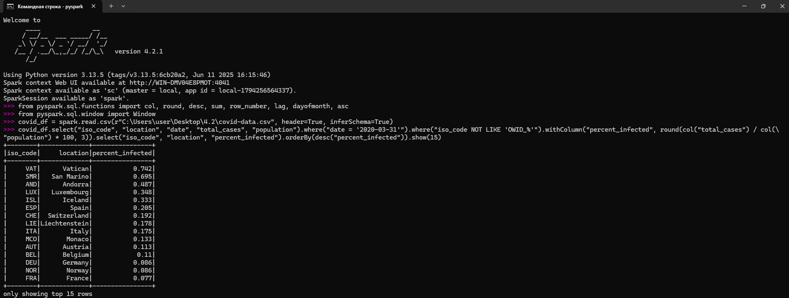
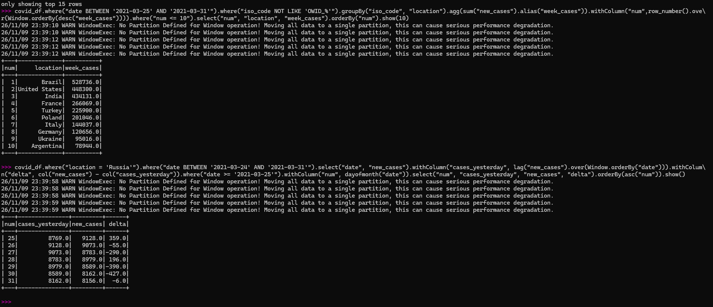

# Домашнее задание по теме «Spark SQL»

**Цель:** изучить датасет по заболеваемости ковид-19 и получить навык работы с DataFrame API

### Задание:
* 1.Выберите 15 стран с наибольшим процентом переболевших на 31 марта (в выходящем датасете необходимы колонки: iso_code, страна, процент переболевших)

* 2.Top 10 стран с максимальным зафиксированным кол-вом новых случаев за последнюю неделю марта 2021 в отсортированном порядке по убыванию
(в выходящем датасете необходимы колонки: число, страна, кол-во новых случаев)

* 3.Посчитайте изменение случаев относительно предыдущего дня в России за последнюю неделю марта 2021. (например: в России вчера было 9150 , сегодня 8763, итог: -387) (в выходящем датасете необходимы колонки: число, кол-во новых случаев вчера, кол-во новых случаев сегодня, дельта)

### Скрипт

*  Импортируем необходимые функции из модуля pyspark.sql библиотеки Apache Spark для решения задач

`from pyspark.sql.functions import col, round, desc, sum, row_number, lag, dayofmonth, asc`
`from pyspark.sql.window import Window`

*  Для чтения датасета создаем переменную covid_df,где указываем путь к файлу covid-data.csv, наличие заголовка (для пропуска первой строки при анализе данных) и автоматическое определение типов данных

`covid_df = spark.read.csv(r"C:\Users\user\Desktop\4.2\covid-data.csv", header=True, inferSchema=True)`

*  15 стран с наибольшим процентом переболевших на 31 марта 2020 года
Так как в отчетах указаны данные не только отдельных стран, но и целых объединений в рамках континентов, частей света и т.д. (iso_code начинается с "OWID_"), необходимо исключить их из анализа

`covid_df.select("iso_code", "location", "date", "total_cases", "population").where("date = '2020-03-31'").where("iso_code NOT LIKE 'OWID_%'").withColumn("percent_infected", round(col("total_cases") / col("population") * 100, 3)).select("iso_code", "location", "percent_infected").orderBy(desc("percent_infected")).show(15)`

* Top 10 стран с максимальным зафиксированным кол-вом новых случаев за последнюю неделю марта 2021 в отсортированном порядке по убыванию

 `covid_df.where("date BETWEEN '2021-03-25' AND '2021-03-31'").where("iso_code NOT LIKE 'OWID_%'").groupBy("iso_code", "location").agg(sum("new_cases").alias("week_cases")).withColumn("num",row_number().over(Window.orderBy(desc("week_cases")))).where("num <= 10").select("num", "location", "week_cases").orderBy("num").show(10)`

* Изменение случаев относительно предыдущего дня в России за последнюю неделю марта 2021

`covid_df.where("location = 'Russia'").where("date BETWEEN '2021-03-24' AND '2021-03-31'").select("date", "new_cases").withColumn("cases_yesterday", lag("new_cases").over(Window.orderBy("date"))).withColumn("delta", col("new_cases") - col("cases_yesterday")).where("date >= '2021-03-25'").withColumn("num", dayofmonth("date")).select("num", "cases_yesterday", "new_cases", "delta").orderBy(asc("num")).show()`

